

  

&nbsp;

  



  



  



  


<table>
<tr>
<td></td>
<td></td>
<td><a href="https://github.com/rizwankairoxaitech/planet_one"></a></td>
</tr>
<tr>
<td><a href="https://github.com/rizwankairoxaitech/island"></a></td>
<td><a href="https://github.com/rizwankairoxaitech/AMARA"></a></td>
<td><a href="https://github.com/rizwankairoxaitech/interior"></a></td>
</tr>
</table>

 


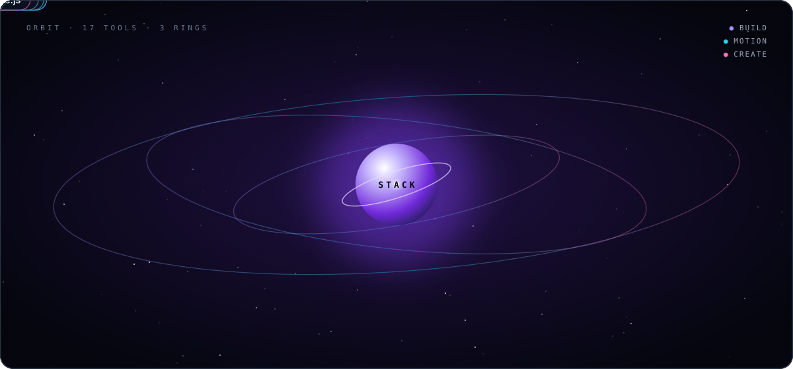

  


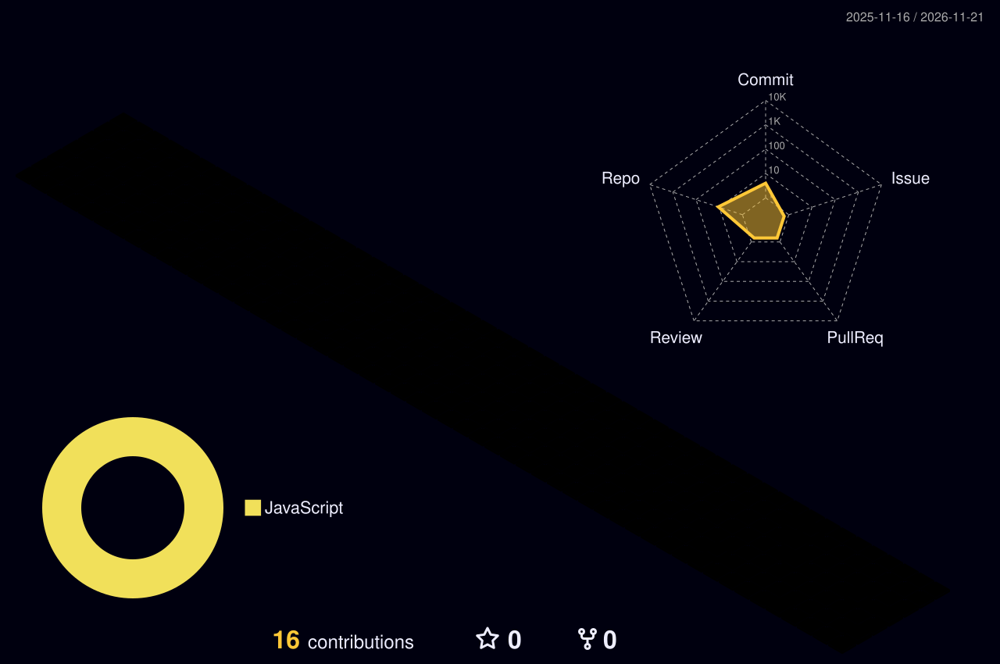

<picture>
  <source media="(prefers-color-scheme: dark)" srcset="https://raw.githubusercontent.com/rizwankairoxaitech/rizwankairoxaitech/refs/heads/output/github-snake-dark.svg"/>
  
</picture>

  


