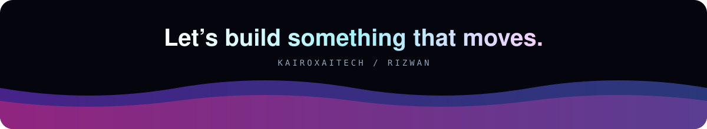

 

&nbsp;

  

 

<table>
<tr>
<td></td>
<td></td>
<td></td>
</tr>
<tr>
<td></td>
<td></td>
<td></td>
</tr>
</table>

 

 

<picture>
  <source media="(prefers-color-scheme: dark)" srcset="https://raw.githubusercontent.com/rizwankairoxaitech/rizwankairoxaitech/output/github-snake-dark.svg"/>
  
</picture>

 

